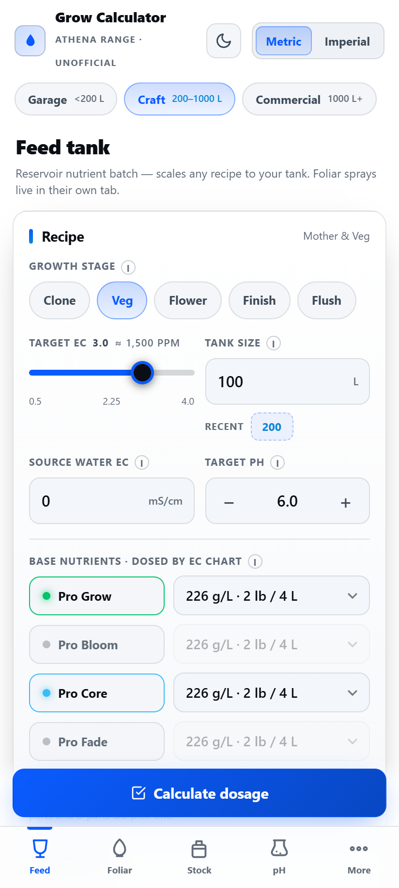
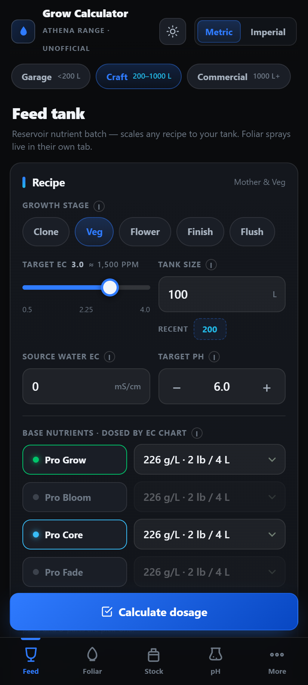

# Athena Grow Calculator

> **This repo is free. My 2am dryback debugging is not.** If it saved you a crop, a weekend, or a nervous breakdown — [buy the rabbit a bag of nutes](https://github.com/sponsors/JakeTheRabbit). If it didn't, keep your money. I respect a tight nutrient budget.

Reservoir dosing, root-zone diagnosis and stock planning for the Athena Pro Line and Blended Line. Runs in the browser, works offline, and stores everything locally.

**Open it: [jaketherabbit.github.io/Athena-Batch-Tank-Nutrient-Calculator](https://jaketherabbit.github.io/Athena-Batch-Tank-Nutrient-Calculator/)**

| Light | Dark |
|---|---|
|  |  |

Not affiliated with, endorsed by, or sponsored by Athena Agriculture. All product names are trademarks of their owners. Verify every mix against the official label.

## Feed tank

Doses one reservoir batch.

- **Nutrient line.** Pro Line (dry powder dissolved into concentrate stock) or Blended Line (liquid A/B dosed from the bottle). Balance and Cleanse are shared by both.
- **Weekly schedule.** Veg W1–W4 and Flower W1–W9, taken from Athena's Grower Toolbox batch tank tool.
  - Pro: EC 3.0 every week. Grow/Bloom 7.4–7.7 g/gal by week, Core 4.6 g/gal, Fade 19 ml/gal in place of Core in F8–F9, Cleanse 2 ml/gal.
  - Blended: the published ml/gal for Grow A/B or Bloom A/B, CaMg, PK and Fade, at that week's chart EC (2.1 veg, 1.7–2.6 flower).
- **Any target EC.** Pro doses come from Athena's grams-per-10 L chart (doc A01.004) divided by the stock strength, linear between EC anchors 0.5–4.0. Blended doses scale with the ratio of nutrient EC to chart EC, so they are exact at the chart EC with RO water.
- **Source water.** RO, tap, well, or custom. Selecting one fills typical EC and pH values and a matching Balance starting rate. Source EC is subtracted from the target, so the finished tank reads the target.
- **Expected tank EC after each addition.** Each dose line shows the EC the tank should read after that product goes in. In Mix mode you enter your meter reading at each step. A reading off by more than ±0.15 EC (or ±8%) is flagged, with the likely cause.
- **Balance.** Blended (liquid potassium silicate), Pro (dry potassium carbonate stock), or Both: Pro powder dissolved into Blended at up to 48 g/L, following Athena's procedure.
- **Top-up.** Enter the running tank's EC. The tool returns the millilitres of each part needed to reach the target, or the litres of water needed to dilute an overshoot.

## Root zone

- **Runoff check.** Enter feed EC/pH, runoff EC/pH and, optionally, runoff % of feed volume. Runoff is compared with Athena's substrate EC target for the crop phase:

  | Phase | Root-zone EC | Source |
  |---|---|---|
  | Veg | 3.5–4.5 | Athena Precision Irrigation Strategy |
  | Stretch (F1–3) | 4–10 | Athena Pro Handbook A01.002 p.40 |
  | Bulk (F4–7) | 3.5–6 | Athena Pro Handbook A01.002 p.40 |
  | Finish (F8–9) | 3–4 | Athena Pro Handbook A01.002 p.40 |

  The output is the feed EC and feed pH to send next, and a button that applies them to the Feed tab. It separates irrigation causes (runoff % too high or too low) from recipe causes, flags salt build-up, and gives Balance guidance for the Balance product you use, including the combined stock.
- **Runoff log and EC trend.** Log one reading a day. With two or more days logged, a least-squares trend gives the runoff EC change per day, the date it will leave the target range, and when to raise feed EC by 0.2. It also flags three consecutive readings with runoff EC at or below feed EC.
- **Balance estimator.** Estimates the Balance dose to move the tank from the current pH to the target pH for Blended, Pro, or the combined stock. Athena publishes no fixed ml-per-pH figure, so the tool learns from each correction you log. Calibration is stored per operation size and per Balance product.

## Foliar, Stock, More

- **Foliar.** IPM/IPW, Stack and Cleanse spray tanks, with presets and the spray procedure.
- **Stock.** Concentrate builder (kilograms of powder for a stock tank at a set strength) and tank life (days of runway and the refill date).
- **More.** Cleanse and Clean Line protocols, saved recipes, calculation history with CSV export, PPM scale, theme, step-by-step setup and the walkthrough.

## First run

A step-by-step setup opens on first launch. It covers the nutrient line and units, batch volume, source water, crop week, stock strength, Balance product and rate, and supplements. Each screen writes straight to the Feed tab, and the last screen calculates the batch. Reopen it from the Feed tab or More.

## Running offline

Download [`www/index.html`](www/index.html) and open it in any modern browser. There is no build step and no backend. On a phone, Add to Home Screen gives a full-screen app.

## Embedding

```html
<iframe src="https://jaketherabbit.github.io/Athena-Batch-Tank-Nutrient-Calculator/?embed=1"
        style="width:100%;border:0" id="athena-calc"></iframe>
```

`?embed=1` hides the header. The page posts its height to the parent on resize.

## Sources and limits

- The weekly Pro and Blended rates come from Athena's Grower Toolbox (growertoolbox.athenaag.com). The Blended rates are from its "Blended with Fade" chart.
- Pro EC scaling uses Athena's Dosage Reference Guide (A01.004) grams-per-10 L master.
- Tank EC after each addition splits the chart EC across products by grams (Pro) or by volume (Blended). Balance, Cleanse and the Pro-line supplements are not part of the chart EC, so treat the per-step values as checkpoints, not lab values.
- The root-zone pH window (5.8–6.4) and the correction rules (feed 5.8 when runoff pH is high, 6.2 when it is low, held for 24–48 h) follow Athena's input range of 5.8–6.2.
- Rates the source could not confirm are marked SEED in the app.

## Requests and bugs

[Open an issue](https://github.com/JakeTheRabbit/Athena-Batch-Tank-Nutrient-Calculator/issues/new/choose). A rate change needs a source: a label photo or an Athena page.

## Development

`www/index.html` is the app: one file of HTML, CSS and vanilla JavaScript with no dependencies. `docs/index.html` is the copy GitHub Pages serves. Keep the two identical.

## License

MIT. See [LICENSE](LICENSE).
